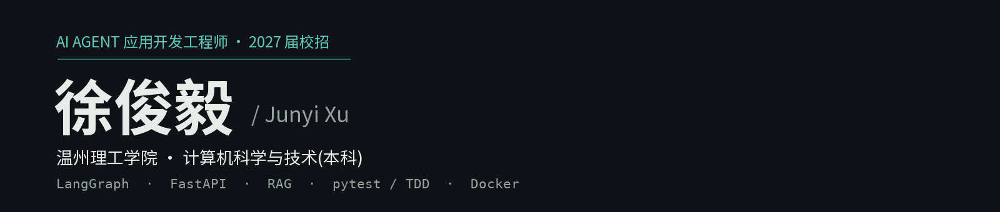

## 徐俊毅

2027 届 · 计算机科学与技术 · 温州理工学院  
方向：**AI Agent 应用开发**（编排落地、业务自动化、可复核交付）

2026.05–2026.08 在联界智能做 AI Agent 开发实习生，独立把 SEO 内容流水线和询盘背调 Relay 做到客户可用；关注的是阶段产物可检查、不确定时停手、以及在真实环境里能跑稳。

## 作品

| 仓库 | 说明 |
| --- | --- |
| [seo-content-workflow-demo](https://github.com/1-1-1-11/seo-content-workflow-demo) | 关键词 → 可发布 SEO 草稿的多 Agent 流水线（脱敏 demo，mock 可本地跑） |
| [lead-verification-relay-demo](https://github.com/1-1-1-11/lead-verification-relay-demo) | 询盘背调 Relay：逐行身份校验 +「宁可停、不可错」（脱敏 demo） |
| [RAG](https://github.com/1-1-1-11/RAG) | 多格式文档检索增强实践，后续业务系统的检索底座 |
| [RainScope](https://github.com/1-1-1-11/RainScope) | 个人 AI 流式阅读工具 |

生产侧对应仓库保持私有；上面两个 `*-demo` 是公开重写版，不含客户数据与密钥。

## 经历与证明

- **联界智能** · AI Agent 开发实习生（2026.05–2026.08）：SEO 工作流、询盘背调助手等业务 Agent 交付与交接
- **诺力智能装备** · 导航定位实习生（2026.08–）：工控机与雷达驱动侧实践（非本页主线）
- RAICOM 机器人开发者大赛 · 省一 · 软考中级（软件设计师）· CET-6 494

---

📫 xtyiyu84@gmail.com · GitHub [@1-1-1-11](https://github.com/1-1-1-11)
