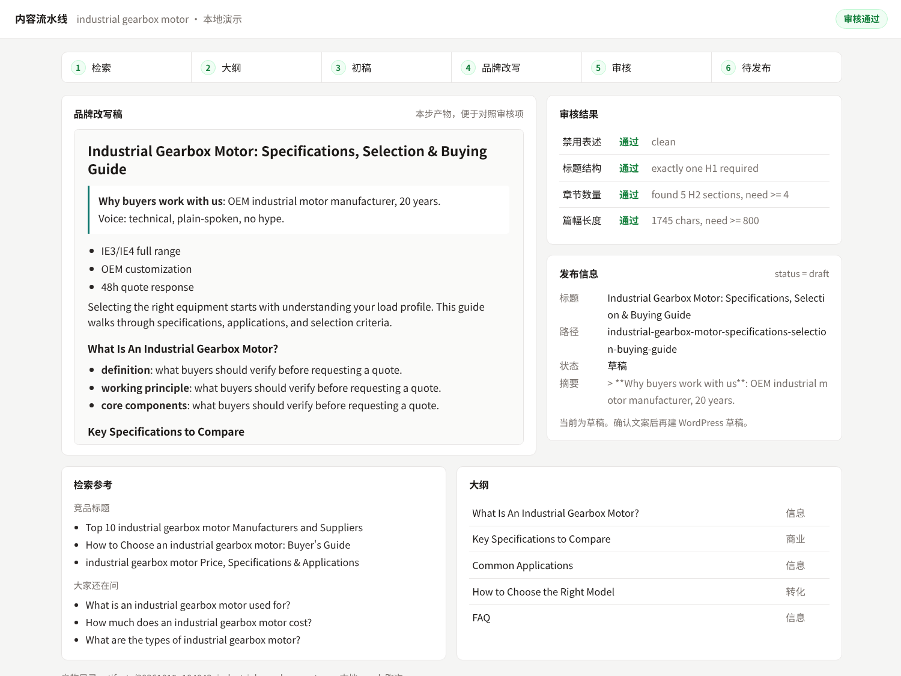
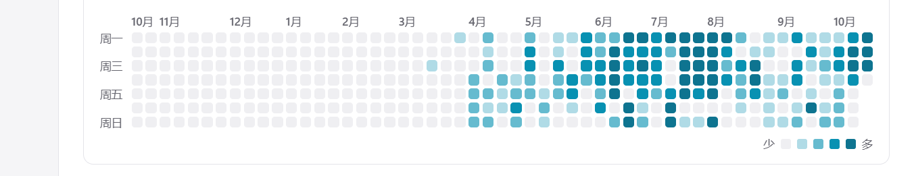

### 徐俊毅 · 2027

写 Agent，也给自己修工具。夏天在联界智能把下面两套交到客户现场用过；公开仓是脱敏版。

| 项目 | 一句话 |
| --- | --- |
| [seo-content-workflow-demo](https://github.com/1-1-1-11/seo-content-workflow-demo) | 从关键词走到可发布的 SEO 草稿。本地 mock 能跑。单篇大约从半天压到十分钟。 |
| [lead-verification-relay-demo](https://github.com/1-1-1-11/lead-verification-relay-demo) | 询盘背调接力：收表、核对、结果写回。对不上的会标出来。 |
| [Proxy](https://github.com/1-1-1-11/Proxy) | CCBaga：给 Claude 固定出口做检查，浏览器跟着同一条链路走。 |
| [RainScope](https://github.com/1-1-1-11/RainScope) | 雨境：降雨数据做成可拖的雨景（含郑州 7·20）。 |

&nbsp;

日常主要在 Claude Code / Codex 里写。下面是 CC Switch 里一年的 Tokens 用量热力图。

邮箱 [xtyiyu84@gmail.com](mailto:xtyiyu84@gmail.com)
